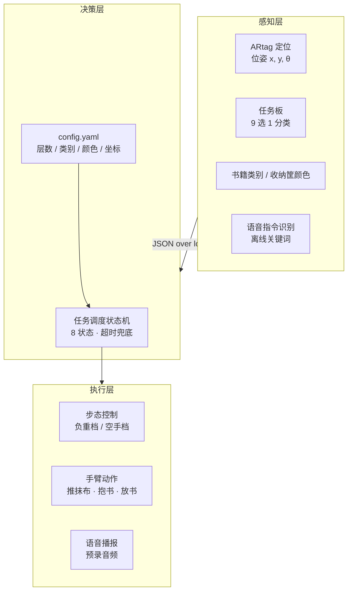
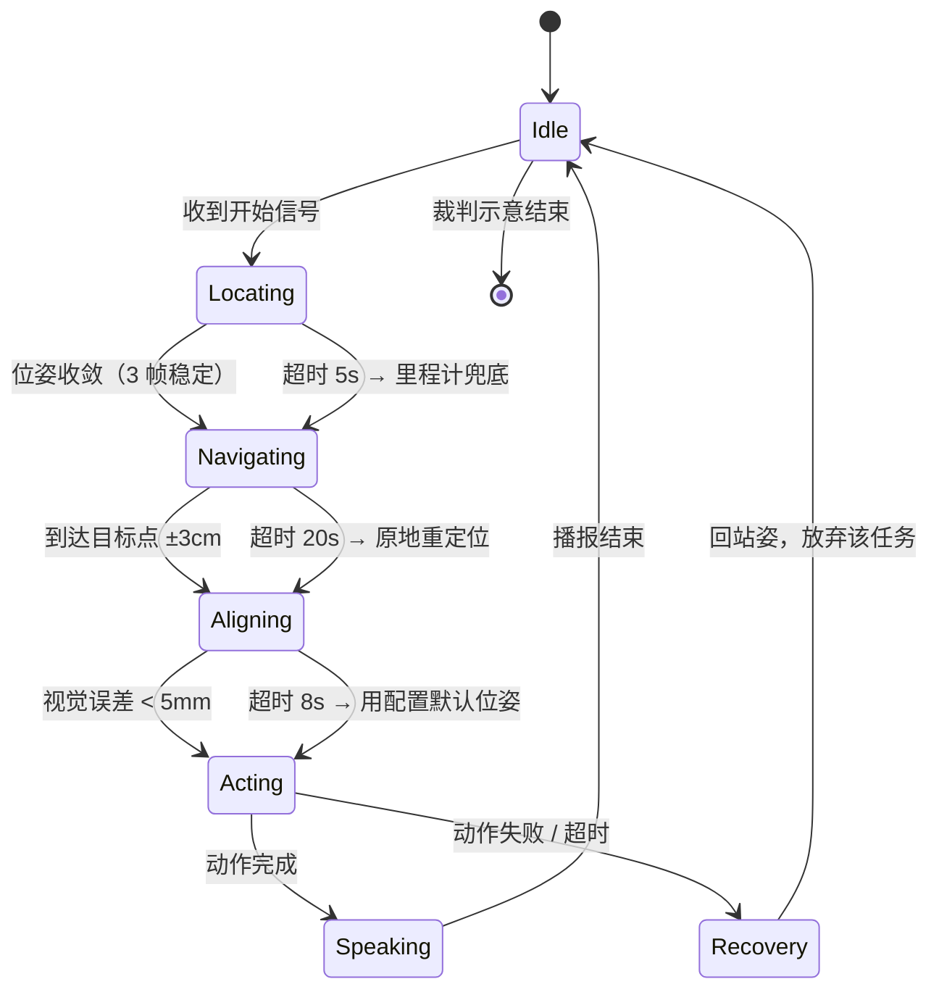
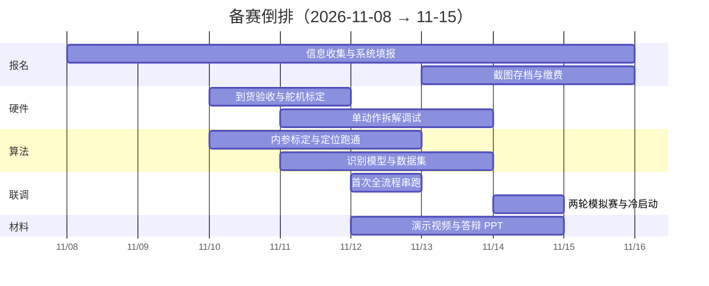

<div align="center">

# 书境智擎

**面向图书馆场景的具身智能作业先锋**

第八届全球校园人工智能算法精英大赛 · 算法应用赛（赛马制）· 赛项十一

`报名冲刺期` · `2026-11` · `双足人形 · 全自主 · 全语音`

</div>

---

## 这是什么

一台 45cm 高的双足人形机器人，在 2.5m × 1.5m 的图书馆场景里独立完成四件事：擦桌子、把书放回书架、读懂任务板、按任务把书送到指定颜色的还书筐。

比赛限时 8 分钟，全程不允许遥控、不允许重启、不允许重试。摔一次超过 15 秒没爬起来，比赛就直接结束。

这个仓库是我们（三人小队）为赛项十一准备的全部技术方案、执行脚本与协作记录。

## 项目状态

| 阶段 | 时间 | 状态 |
|---|---|---|
| 方案设计 | 2026-11-08 | 完成，本仓库内容 |
| 报名提交 | 2026-11-15 20:00 截止 | 进行中 |
| 复赛（省级） | 2026-11-15 — 11-30 | 未开始 |
| 全国总决赛 | 2026-12 | 未开始 |

## 我们怎么打

赛题总分 185 分，其中 **85 分（45.9%）押在「不用遥控器 + 语音触发」上**。这不是加分项，是主战场。整个方案围绕三条判断展开：

**一、全语音路线的下限，比遥控器路线的上限还高。**
遥控器路线理论满分 100 分；全语音路线只要三次语音触发成功、干净完成「清洁桌面」，就是 40 + 45 + 20 = 105 分。所以「手不碰遥控器」是纪律，不是偏好。

**二、任务板不是 OCR 问题，是 9 选 1 分类问题。**
题目限定 3 种书籍类别 × 3 种收纳筐颜色，共 9 种组合，且内容赛前公布。模板匹配足够，不需要大模型，树莓派算力毫无压力。同理，书架层数与摆放位置也都赛前公布，可以配置化固化为 `config.yaml`，改配置不改代码。

**三、任务排序按风险，不按分值。**
收纳环节要抱书登 1cm 台阶，是全场摔倒率最高的动作，而摔倒即终止。所以顺序定为：

```
清洁桌面(20) → 读取任务板(15) → 学无止境(35) → 收纳(30)
```

进入最后一个环节前，70 分已经落袋。

## 得分结构

| 模块 | 分值 | 得分形态 | 失败代价 |
|---|---:|---|---|
| 清洁桌面 | 20 | 5 + 5 + 10 累加 | 局部损失 |
| 收纳 | 30 | 5 + 3 + 7 + 10 + 5 累加 | 分档最细，保底性强 |
| 读取任务板 | 15 | 5 + 10 累加 | 影响学无止境前置条件 |
| 学无止境 | 35 | 10 + 20 + 5 累加 | 拿错书直接损失 30 分 |
| 全程不使用遥控器 | 40 | 一票制 | 一次触碰即全失 |
| 语音指令（3 次区域触发） | 45 | 每次 15 分 | 每失败一次损失 15 分 |

## 系统架构



三条工程约束贯穿全案：

- **不摔优先于快** —— 摔倒终止等于冻结全部得分，慢 60 秒只影响同分排名。
- **不出界优先于进框** —— 进框是得分项，可差 2 厘米；双脚出界是终止项，零容忍。
- **不重启优先于修得快** —— 容错做在进程层，视觉/语音/运动各自独立进程，守护进程 3 秒拉起，机器人保持站立不动。

## 任务执行状态机



核心设计：异常恢复的默认动作是**放弃当前任务、转下一任务**，而不是重试。因为规则明确「任务无重试」，任何原地纠缠都在消耗不可回收的时间。

## 文档导航

| 文档 | 内容 | 谁该看 |
|---|---|---|
| [赛题解析](docs/01-赛题解析.md) | 185 分怎么来的、规则红利、硬约束与终止条件 | 全员必读 |
| [技术方案](docs/02-技术方案.md) | 三层架构、接口约定、四大任务技术路径与验收 | 技术组 |
| [执行手册](docs/03-执行手册.md) | 秒级时间轴、状态机、语音额度记账表、四级降级预案 | 比赛现场必带 |
| [分工与计划](docs/04-分工与计划.md) | 责任矩阵、交付物验收、倒排日历、团队级验收 | 全员 |
| [风险与待确认](docs/05-风险与待确认.md) | 10 项风险登记、8 个必须问组委会的问题 | 队长 / 外联 |

原始 Word 版（用于打印与提交）：[书境智擎-赛项11项目整体策划书.docx](docs/assets/书境智擎-赛项11项目整体策划书.docx)，与本仓库 Markdown 内容同源，以 Markdown 为准。

## 团队分工

| 成员 | 职责 | 关键交付 |
|---|---|---|
| 汪俊杰 | 流程 · 语音 · 系统集成 · 步态控制 | 8 分钟脚本、状态机、语音记账表、`run_all` 入口、冷启动报告 |
| 范昕彦 | 视觉识别 · 演示视频 | ARtag 定位、任务板 9 选 1、书籍与筐分类、演示成片 |
| 陆可馨 | 对外联络 · 报名材料 · 答辩主讲 | 对接台账、报名材料包、8 页 PPT 与逐字稿、比赛录像双备份 |

## 时间线

今天距报名截止 7 天，且**复赛窗口与报名截止是同一天（11/15）开启**，不存在「报完名再准备」的余地。



最大风险是硬件到货时间。若 11/11 仍未到货，视觉与语音必须在无硬件条件下先行——用录制视频做离线开发，用录音做语音链路测试，不得以「等机器人」为由停滞。

## 协作规范

分支、提交与文档更新规则见 [CONTRIBUTING.md](CONTRIBUTING.md)。

## 联系

| 角色 | 联系方式 |
|---|---|
| 指导教师 | 刘老师 |
| 赛题联系人（乐聚） | 梁鹏飞 15287419948 |
| 赛题交流群 | QQ 964331638 |

---

<div align="center">
<sub>赛项十一 · 具身智能机器人任务挑战赛 · 2026</sub>
</div>
