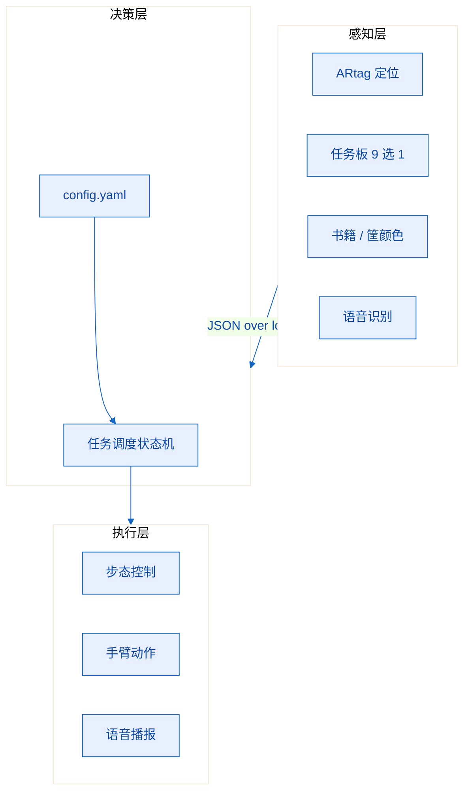

<div align="center">

# 书境智擎

**面向图书馆场景的具身智能作业先锋**

一台 45cm 高的双足人形，8 分钟内独立完成擦桌、归架、读板、送书

</div>

| 赛事 | 赛项 | 队伍 | 提交死线 |
|---|---|---|---|
| 第八届全球校园人工智能算法精英大赛<br>算法应用赛 · 赛马制 | 赛项十一<br>具身智能机器人任务挑战赛 | 3 人 | **2026-11-15 20:00** |

> **快速入口**
>
> - 整体方案：[`docs/01-赛题解析.md`](docs/01-赛题解析.md) —— 185 分是怎么构成的
> - 现场执行手册：[`docs/03-执行手册.md`](docs/03-执行手册.md) —— 打印出来带去赛场
> - 打印版策划书：[`docs/assets/书境智擎-赛项11项目整体策划书.docx`](docs/assets/书境智擎-赛项11项目整体策划书.docx)
> - 术语速查：[`docs/06-术语表.md`](docs/06-术语表.md)

---

## 一句话说清这个作品

> 别人做的是**「让它能做到」**，我们做的是**「让它每次都做到」**。
> 演示成功靠调参，比赛拿分靠不出错。

擦桌子、抱书、上 1cm 台阶、把书放进筐——这些动作单拎出来，都是人形机器人的基本功，没有一项需要突破性算法。

真正决定成绩的是规则里那几条不起眼的限制：

- 计时**无暂停**，8 分钟走完就走完
- 任务**无重试**，一次失败就进入下一项
- 机器人**无重启**，崩了只能靠进程自己活过来
- 摔倒 **15 秒**未起身，比赛直接结束
- 全程语音指令 **≤ 8 次**

所以这个项目的技术重心不在「能不能做到」，而在三件事：**语音一次就听懂、定位绝不越界、崩了能自己恢复**。

---

## 赛事信息

| 项 | 内容 |
|---|---|
| 赛事 | 第八届全球校园人工智能算法精英大赛（[官网](https://www.aicomp.cn/)） |
| 赛道 | 算法应用赛（赛马制），全国统一组织、不分赛区 |
| 赛项 | 十一 · 具身智能机器人任务挑战赛 |
| 阶段 | 初赛（校赛）→ 复赛 11/15—11/30 → 全国总决赛 12 月 |
| 组队 | 每队 ≤3 人，≤2 名指导教师，禁止跨校 |
| 单场时长 | 8 分钟，两次机会取高分，两次之间无调试时间 |
| 参赛费 | 复赛 500 元 / 队 |
| 场地 | 2.5m × 1.5m，刀刮布地面，ARtag 辅助定位 |
| 机器人 | 身高 ≤45cm，自由度 ≥17，双足直立，电池 ≤8.6V |

完整规则拆解见 [`docs/01-赛题解析.md`](docs/01-赛题解析.md)。

---

## 核心判断：85 分不在任务里

赛题总分 185 分，但它的分布很反常——**四项任务加起来只有 100 分，另外 85 分不看机器人做得多好，只看两件事：你有没有碰遥控器，你有没有用语音触发**。

| 模块 | 分值 | 得分形态 | 失败代价 |
|---|---:|---|---|
| 清洁桌面 | 20 | 5 + 5 + 10 累加 | 局部损失 |
| 收纳 | 30 | 5 + 3 + 7 + 10 + 5 累加 | 分档最细，保底性强 |
| 读取任务板 | 15 | 5 + 10 累加 | 影响学无止境前置条件 |
| 学无止境 | 35 | 10 + 20 + 5 累加 | 拿错书直接损失 30 分 |
| **全程不使用遥控器** | **40** | 一票制 | 一次触碰即全失 |
| **语音指令（3 次区域触发）** | **45** | 每次 15 分 | 每失败一次损失 15 分 |

由此得出三条判断，后续所有设计都是它们的展开：

**一、全语音路线的下限，比遥控器路线的上限还高。**
遥控器路线理论满分 100 分；全语音路线只要三次触发成功、干净完成清洁桌面，就是 40 + 45 + 20 = **105 分**。所以「手不碰遥控器」是纪律，不是偏好。

**二、任务板不是 OCR 问题，是 9 选 1 分类问题。**
题目限定 3 种书籍类别 × 3 种收纳筐颜色，共 9 种组合，且内容赛前公布。模板匹配足够，不需要大模型。同理，书架层数与摆放位置也都赛前公布，可以固化进 `config.yaml`——改配置不改代码。

**三、任务排序按风险，不按分值。**
收纳要抱书登 1cm 台阶，全场摔倒率最高，而摔倒即终止。所以顺序定为：

```
清洁桌面(20) → 读取任务板(15) → 学无止境(35) → 收纳(30)
```

进入最后一个环节前，70 分已经落袋。

---

## 系统设计



三层之间只有一条数据通道：感知层输出位姿与识别结果，决策层决定下一步，执行层做动作。接口先定死，视觉与语音才能在机器人到货前独立开发。

三条工程约束贯穿全案，冲突时优先级从高到低：

1. **不摔优先于快** —— 摔倒终止等于冻结全部得分，慢 60 秒只影响同分排名。
2. **不出界优先于进框** —— 进框是得分项，可差 2 厘米；双脚出界是终止项，零容忍。
3. **不重启优先于修得快** —— 容错做在进程层，视觉/语音/运动各自独立进程，守护进程 3 秒拉起，机器人保持站立不动。

### 任务执行状态机

八个状态：待机 → 定位 → 导航 → 对准 → 执行 → 播报，外加异常恢复与结束。每个状态都有明确的超时阈值，超时即降级，绝不静默等待。

最重要的设计是：**异常恢复的默认动作是「放弃当前任务、转下一任务」，而不是重试**。规则明确「任务无重试」，原地纠缠只会消耗不可回收的时间。

完整状态图与状态迁移表见 [`docs/03-执行手册.md`](docs/03-执行手册.md)。

---

## 语音额度：只有 8 次机会

这是全案最容易被忽视、也最致命的一页。

规则限定全程语音指令 ≤8 次。按最严口径（人机全部计数），我们已经排满 **7 句**，只剩 1 次冗余：

| # | 时机 | 说话方 | 内容 | 对应得分 |
|---|---|---|---|---|
| 1 | 茶水区框外 | 人 | 「清洁桌面」 | 15 |
| 2 | 茶水区框内 | 人 | 「开始清洁桌面」 | 5 |
| 3 | 任务发布区框外 | 人 | 「读任务板」 | 15 |
| 4 | 任务发布区框内 | 机器人 | 复述任务指令 | 10 |
| 5 | 目标筐前 | 机器人 | 「送达完毕」 | 5 |
| 6 | 收纳区框外 | 人 | 「收纳」 | 15 |
| 7 | 收纳区框内 | 机器人 | 「收纳完成」 | 5 |

如果裁判认定机器人自主播报不计入额度，人只需说 3 句，冗余 5 次；如果全部计入，冗余只有 1 次——**每一次开口都必须一次命中**。这个口径差异直接决定语音模块的可靠性门槛，已列入待确认清单第 2 项。

记账表打印成 A4 贴在场边，说一句划一次。任何人想临时加一句话，先看表再开口。

---

## 目录结构

```
.
├── README.md                 ← 你在这里
├── CONTRIBUTING.md           ← 分支、提交、接口变更规则
├── docs/
│   ├── 01-赛题解析.md         185 分拆解、规则红利、硬约束、终止条件
│   ├── 02-技术方案.md         三层架构、接口协议、四任务技术路径
│   ├── 03-执行手册.md         秒级时间轴、状态机、语音记账表、降级预案
│   ├── 04-分工与计划.md       责任矩阵、交付物验收、倒排日历
│   ├── 05-风险与待确认.md     10 项风险、8 个待问组委会的问题
│   ├── 06-术语表.md           五类术语的落地解释
│   └── assets/               打印版策划书 .docx
└── output/                   构建产物（已 gitignore）
```

代码目录待机器人到货后建立：`src/vision`（定位与识别）、`src/voice`（语音链路）、`src/motion`（步态与动作）、`config/`（现场配置）。

---

## 当前进度

> 状态以 2026-11-08 为准。方案已定稿，硬件尚未到货，代码未开始。

| 模块 | 状态 | 备注 |
|---|---|---|
| 赛题解析与得分建模 | ✅ 完成 | 185 分结构、三条核心判断、任务排序已定 |
| 整体方案 | ✅ 完成 | 本仓库全部文档，另有 23 页打印版 |
| 技术方案与接口设计 | ✅ 完成 | 三层架构、JSON 协议、配置字段已约定 |
| 8 分钟执行脚本 | ✅ 完成 | 秒级时间轴，测算 7 分 00 秒，缓冲 60 秒 |
| 语音额度记账表 | ✅ 完成 | 7 句台词定稿，待打印 |
| 报名材料 | 🟡 进行中 | 信息收集，11/15 20:00 截止，截止后不可改 |
| 机器人到货验收 | 🔴 待办 | 舵机 ID、中位标定、站姿调平、重心确认 |
| 视觉模块 | 🔴 待办 | 内参标定、ARtag 定位、任务板 9 选 1 |
| 语音模块 | 🔴 待办 | 离线识别 + 预录音频，200 次测试要求命中率 ≥98% |
| 动作调试 | 🔴 待办 | 每个动作单独调通并录像存档 |
| 演示视频 | 🔴 待办 | 场地全景 + 任务完成 + 团队讨论 |
| 答辩 PPT | 🔴 待办 | 8 页 + 逐字稿，掐表 3 遍 |

硬件若迟于 **11/11** 到货，计划压缩为 11/12—11/14 三天冲刺。前提是视觉与语音在无硬件条件下先行——用录制视频做离线开发，不得以「等机器人」为由停滞。

---

## 已知风险

主动写出来，不藏着。

| 风险 | 为什么危险 | 对策 |
|---|---|---|
| 机器人到货延迟 | 唯一一个「努力也解决不了」的风险 | 视觉语音离线先行，到手后只做动作标定 |
| 语音现场识别失败 | 一次失败损失 15 分，最差损失 85 分 | 近场麦 + 预录音频 + 备用触发词 + 200 次测试 |
| 登台阶摔倒 | 15 秒未起身即终止，等于全场归零 | 保守步态 + 负重档单独标定 + 倒地自起专项训练 |
| 侧光或反光导致 tag 丢失 | 定位失准可能出界 | 里程计 1 秒兜底 + 多 tag 冗余 + 自带遮光板 |
| 报名信息错漏 | 截止后一个字都不能改 | 双人交叉复核 + 提交截图存档 |
| 「两遍制」口径不明 | 若一场需跑两遍，现有时间轴不成立 | 已备 3.5 分钟精简版分支 |

还有 8 个问题必须问组委会，其中两个会直接改变方案：「连续完成 2 次规定任务」是一场跑两遍还是两轮各一次、语音额度是否含机器人自主播报。清单见 [`docs/05-风险与待确认.md`](docs/05-风险与待确认.md)。

---

## 团队

| 角色 | 负责线 | 核心交付物 |
|---|---|---|
| 汪俊杰 | 流程 · 语音 · 系统集成 · 步态 | 8 分钟脚本、状态机、语音记账表、启动入口、冷启动报告 |
| 范昕彦 | 视觉 · 演示视频 | ARtag 定位、任务板 9 选 1、书籍与筐分类、演示成片 |
| 陆可馨 | 外联 · 报名 · 答辩 | 对接台账、报名材料包、8 页 PPT 与逐字稿、比赛录像双备份 |

分工原则：**每人一条完整链路，不按环节切**。共同负责等于无人负责，所以每人有明确主责、明确决策权、明确备份项。

详见 [`docs/04-分工与计划.md`](docs/04-分工与计划.md)。

---

## 协作规范

三条硬规则，完整版见 [`CONTRIBUTING.md`](CONTRIBUTING.md)：

- **分支**：`main` 只放随时可交付的状态。开发走 `feat/<模块>`、`fix/<问题>`、`docs/<主题>`，合并前至少一人看过。赛前一天可直接推 `main`，但要在群里同步一句改了什么。
- **提交**：格式 `<类型>: <一句话>`，类型限 `feat` / `fix` / `docs` / `refactor` / `test` / `chore`。禁止 `update`、`修改`、`111` 这类无信息量的写法。
- **文档同步**：改完代码顺手改对应文档，不留到「以后统一整理」。接口变更先改文档再改代码，并在站会通报版本号。

另有两项约定值得提前知道：**配置与代码分离**——赛前公布的三项变量只允许出现在 `config.yaml`，不得硬编码进业务逻辑；**报名信息双人核对**——截止后一个字都不能改，任何涉及姓名、学号、身份证号的改动必须两个人过目。

推送失败时怎么查，见 [`CONTRIBUTING.md`](CONTRIBUTING.md) 第六节。

---

## 文档索引

| 想看什么 | 去哪里 |
|---|---|
| 185 分怎么来的、哪些分最好拿 | [`docs/01-赛题解析.md`](docs/01-赛题解析.md) |
| 系统怎么搭、四个任务分别怎么做 | [`docs/02-技术方案.md`](docs/02-技术方案.md) |
| **明天上场怎么走位、说什么话** | [`docs/03-执行手册.md`](docs/03-执行手册.md) |
| 谁负责什么、哪天交什么 | [`docs/04-分工与计划.md`](docs/04-分工与计划.md) |
| 会出什么问题、要问组委会什么 | [`docs/05-风险与待确认.md`](docs/05-风险与待确认.md) |
| 某个词是什么意思 | [`docs/06-术语表.md`](docs/06-术语表.md) |
| 要打印给老师的完整方案 | [`docs/assets/`](docs/assets/) |
| 分支怎么开、提交怎么写、推送失败怎么查 | [`CONTRIBUTING.md`](CONTRIBUTING.md) |

---

## License

文档与方案内容版权归团队所有，仅用于本次赛事评审。代码部分计划采用 MIT。
