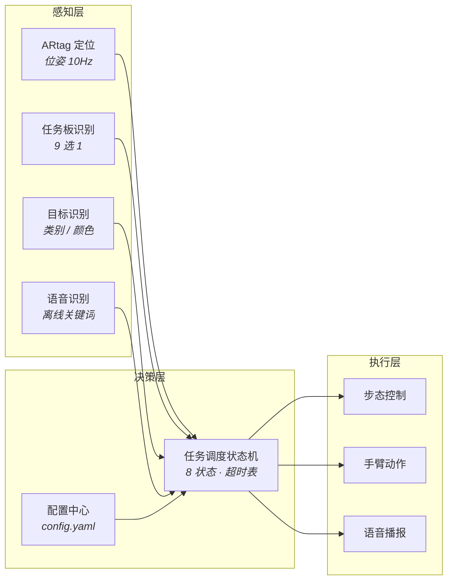

# 技术方案

## 一、设计原则

整个系统按三条原则约束，冲突时优先级从高到低：

1. **确定性优先于先进性**。赛题的三项关键变量赛前公布，能用配置和模板匹配解决的，不上模型。树莓派算力有限，每一分算力都要花在规则要求在线判断的地方。
2. **可离线优先于可扩展**。现场可能无网络，任何依赖云端 ASR、在线 TTS、远程模型的方案一律视为不可用。
3. **可恢复优先于不犯错**。8 分钟无暂停、无重试、无重启，系统必须能在进程崩溃后 3 秒自愈，且机器人保持站立不动。

## 二、三层架构



### 模块职责与接口

| 层级 | 模块 | 职责 | 对外接口 |
|---|---|---|---|
| 感知 | 定位 | ARtag 识别，输出场地坐标与朝向 | `{x, y, theta, conf}` @ `localhost:5000` |
| 感知 | 识别 | 任务板 9 选 1、书籍类别、收纳筐颜色、抹布位置 | `{category, color, bbox, conf}` |
| 感知 | 语音输入 | 关键词唤醒与指令识别 | 事件回调 `on_command(text, conf)` |
| 决策 | 任务调度器 | 状态推进、任务排序、超时处理 | 内部 |
| 决策 | 配置中心 | 层数、类别、颜色、坐标等赛前变量 | `config.yaml` |
| 执行 | 步态控制 | 直线、转向、台阶、站姿保持 | `walk(distance, heading)` |
| 执行 | 手臂动作 | 推抹布、抱书、放书 | `action(name)` |
| 执行 | 语音播报 | 预录音频播放 | `speak(clip_id)` |

### 为什么接口要先定死

三人并行开发，且硬件可能晚到。接口定死后，视觉与语音可以在**没有机器人**的条件下，用录制的场地视频与音频独立调试；动作组可在机器人到位后单独标定。三方通过 JSON 协议对接。

> 接口变更规则：谁改协议谁负责通知，并在每日站会上确认版本号。

## 三、配置驱动

赛前调试阶段才公布的三项变量必须由配置文件承载，禁止写进代码：

```yaml
task:
  shelf_level: 2          # 1 或 2，赛前公布
  target_category: "文学"  # 文学 / 工具 / 少儿
  target_bin: "黄"         # 黄 / 蓝 / 绿

poses:
  book_staging: [0.42, 0.18, 90]
  bin_yellow:   [1.85, 0.35, 270]
  shelf_front:  [1.20, 1.05, 0]
```

**验收方式**：由未参与开发的同学在 5 分钟内完成一次配置修改并成功运行，即为合格。这条看似简单，实际决定了赛前一晚能否快速适配临时公布的题目。

## 四、容错与可观测性

### 进程隔离

```
supervisor
├── vision   (定位 + 识别)   崩溃 → 3s 内拉起
├── voice    (唤醒 + 识别 + 播报)
└── motion   (步态 + 动作)
```

任一进程退出后 3 秒内拉起，机器人**保持当前站姿不动**。注意：规则禁止「机器人重启」，但不禁止上位机进程重启——容错必须做在进程层。

### 降级链

| 场景 | 动作 | 允许时长 |
|---|---|---|
| ARtag 丢失 | 切里程计推算 | 1 秒内 |
| 持续丢失 | 停止动作，原地重定位 | 3 秒内 |
| 重定位连续失败 | 放弃当前任务，转下一任务 | 立即 |
| 识别置信度不足 | 双帧重拍一次 | 5 秒内 |

### 统一日志

每条记录为单行 JSON：

```json
{"t": 42.31, "module": "vision", "action": "localize", "result": "ok", "conf": 0.94}
```

`t` 为相对开赛秒数。赛后用脚本回放，可直接回答「第几秒发生了什么」。

### 冷启动

断电重启到可运行 ≤ **60 秒**，含相机启动、模型加载、舵机自检、语音引擎唤醒四项。连续 3 次通过为合格。

## 五、四大任务技术方案

### 5.1 清洁桌面（20 分）

**得分点**：进框 5 · 框内播报 5 · 推过线且不掉落 10

**技术路径**
- 进框判定用 ARtag 位姿，不用视觉找线——黑线在刀刮布上的对比度受现场光照影响大，而 tag 位姿是绝对量。
- 抹布尺寸 4—5 × 8—9 × 5—6cm，动作形态为「掌面贴合前推」，不是「抓取后放置」。抓取会引入夹持失败这一额外风险。

**关键难点**
茶水桌仅 40 × 30cm，抹布推过终点线后继续施力即掉落，而掉落直接判该项失败。因此推力必须在过线后 2cm 内收住。

**方案**：把「推」拆成三段短推（每段约 3cm），每段结束检查抹布相对位置，用短推堆叠代替一次长推。

**失败模式**：推力方向偏斜导致斜出桌沿 / 推力不足未过线 / 推速过快导致抹布翻倒。

**验收**：连续 10 次，过线且不掉落 ≥ 9 次。

### 5.2 收纳（30 分）

**得分点**：进框 5 · 抱书 3 · 登台阶 7 · 放到指定层 10 · 播报 5

**技术路径**
- 7cm 立方体，双手夹持。
- 1cm 台阶看似低，但对双足机器人意味着重心前移与落脚点抬高，是全场最高摔倒风险动作。
- 书架 37—38cm 高，相对 45cm 身高，二层取放需抬臂至接近极限位，动作必须分步完成。

**关键难点**
抱书后双臂被占用，重心前偏，上台阶稳定性显著低于空手。**步态参数必须按「负重档」单独标定，不能复用空手参数。**

**验收**（按动作细分，不做笼统统计）
- 抱书 10 次 → ≥ 10 次成功
- 登台阶 10 次 → ≥ 9 次
- 放书入层 10 次 → ≥ 8 次

### 5.3 读取任务板（15 分）

**得分点**：进框 5 · 框内播报正确指令 10

**技术路径**
任务板高 21—22cm，贴纸 9 张（15 × 10cm），内容限定为「将 X 类书籍搬到 Y 色收纳筐内」，共 9 种组合。因此本任务的本质是 **9 选 1 图像分类**，不是 OCR。

采用模板匹配（pHash 或 ORB 特征）即可覆盖，无需大模型，树莓派算力完全够用。

**关键难点**
- 印刷贴纸有侧光与高光，采集时避开高光角度。
- 抬臂取景时手臂可能遮挡贴纸下缘，识别失败允许小幅调整机位重拍一次（不消耗语音额度）。

**验收**：20 张不同角度与光照样本，9 类分类准确率 **100%**。类别空间只有 9 个，任何错分都是工程缺陷而非算法极限。

### 5.4 学无止境（35 分）

**得分点**：拿起正确书籍 10 · 放入正确筐 20 · 播报 5

**技术路径**
- 书籍三类区分优先依赖**书脊标签与主色**这类机器视觉易稳拿的特征，不依赖深度模型。
- 收纳筐颜色采用 HSV 阈值分割，固定光照下比神经网络更稳定且可解释。
- 数据集：3 类书 × 3 色筐各 20 张，由范昕彦主导采集，陆可馨协助。

**关键难点**
拿错类别书直接损失 35 分中的 30 分，是全案最昂贵的单点错误。**必须设置双帧确认**：连续两帧结果一致且置信度均超阈值才允许抓取，任一帧不一致则退回重拍。宁可多花 5 秒，不可拿错。

**验收**
- 3 类 × 3 色各 20 张，分类准确率 ≥ 98%
- 混入 10% 遮挡样本后准确率 ≥ 95%

## 六、系统集成清单

| # | 交付物 | 验收标准 | 责任人 |
|---|---|---|---|
| 1 | 总入口 `run_all.sh` | 一条命令启动全部模块，失败自动重试一次 | 汪俊杰 |
| 2 | 自检 `selfcheck.py` | 相机、麦克风、舵机、串口、模型文件五项逐项报 OK/FAIL | 汪俊杰 |
| 3 | 统一日志系统 | 每动作带时间戳，可按秒回溯 | 汪俊杰 |
| 4 | 冷启动记录 | 断电重启至可运行 ≤60 秒，连续 3 次通过 | 汪俊杰 |
| 5 | 视觉服务 `vision_server.py` | 支持视频文件离线输入，无硬件可独立运行 | 范昕彦 |
| 6 | 定位精度报告 | 场地 9 点采样，位置误差 ≤5cm，朝向误差 ≤5° | 范昕彦 |

## 七、语音子系统

### 选型

| 组件 | 选型 | 理由 |
|---|---|---|
| 语音识别 | Vosk 中文小模型 / 固定唤醒词匹配 | 词表封闭（7 句以内），无需通用识别 |
| 语音合成 | **预录 wav 为主**，piper 离线 TTS 兜底 | 预录可消除合成失败与音色漂移 |
| 拾音 | 近场麦克风，选手站位固定 | 8 次额度不容许重复，信噪比优先 |

### 关键设计：所有播报都可预录

任务板内容限定 9 种组合且赛前公布，机器人需要说的四句话（任务指令、送达完毕、收纳完成、触发确认）全部可提前录制为音频文件。TTS 仅作为「公布内容超出预期」时的兜底。这一设计把「现场合成失败」整类风险直接消除。

### 触发词设计

框外触发与框内播报必须音素差异明显，避免误识别：

| 时机 | 说话方 | 短语 |
|---|---|---|
| 茶水区框外 | 人 | 「清洁桌面」（短词） |
| 茶水区框内 | 人 | 「开始清洁桌面」（完整句） |
| 任务发布区框外 | 人 | 「读任务板」 |
| 任务发布区框内 | 机器人 | 复述任务指令 |
| 收纳区框外 | 人 | 「收纳」 |
| 收纳区框内 | 机器人 | 「收纳完成」 |
| 目标筐前 | 机器人 | 「送达完毕」 |

### 识别指标

赛前完成 **200 次连续识别测试**，统计一次命中率，要求 **≥ 98%**。未达标不得进入模拟赛阶段。测试必须在真实场地噪声条件下进行，不能在安静实验室完成。
