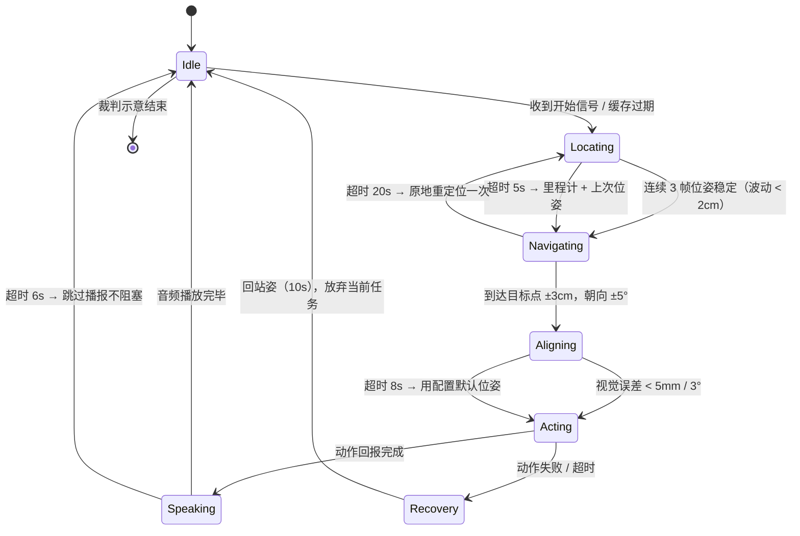

# 执行手册

> 这份文档是比赛现场要用的。建议打印 A4 贴于场地边，或存为手机离线文档。

## 一、任务排序决策

规则允许前三项任务自由排序，仅要求「学无止境」必须在「读取任务板」之后。

按「风险 × 分值」排序，最优顺序：

```
清洁桌面(20) → 读取任务板(15) → 学无止境(35) → 收纳(30)
```

**三条依据**

1. 收纳含登台阶，摔倒风险最高，一旦摔倒全场终止，必须置于分数落袋之后。
2. 学无止境依赖任务板结果，逻辑上必须在读取之后。
3. 清洁桌面动作最简单、确定性最高，开局完成可稳定入账 20 分并建立节奏。

按此顺序，进入收纳环节前已锁定 70 分；即使最后一环失败，加上 85 分加成项，总分仍可达 155。

> 场地仅 2.5 × 1.5m，走位距离差异不足以推翻风险排序，因此不按路径最短原则调整。

## 二、秒级时间轴

基于步速 0.15m/s 的保守假设编制。**首轮实测后必须按实测数据重排**，「缓冲」列即为重排余量。

| 时刻 | 动作 | 语音事件 | 缓冲 |
|---|---|---|---|
| 0:00 | 裁判宣布开始，确认程序运行 | — | 0s |
| 0:00—0:08 | 系统自检，日志显示五项 OK | — | 12s |
| 0:08—0:20 | 站立待机 → 定位中，≥2 个 tag 收敛 | — | 10s |
| 0:20—0:35 | 走向茶水区，停在黑线框外 5cm | — | 10s |
| 0:35—0:42 | 框外触发 | ① 人：「清洁桌面」 | 5s |
| 0:42—0:50 | 完全进入框内，留 3cm 余量 | — | 5s |
| 0:50—0:55 | 框内播报 | ② 人：「开始清洁桌面」 | 5s |
| 0:55—1:30 | 三段短推抹布，过线并收力 | — | 20s |
| 1:30—1:45 | 退框，转身朝任务发布区 | — | 10s |
| 1:45—2:00 | 行至任务发布区框外 5cm | — | 10s |
| 2:00—2:07 | 框外触发 | ③ 人：「读任务板」 | 5s |
| 2:07—2:15 | 完全进入框内 | — | 5s |
| 2:15—2:35 | 抬臂取景 → 9 选 1 → 双帧确认 | — | 10s |
| 2:35—2:45 | 框内播报任务指令 | ④ 机：复述任务 | 5s |
| 2:45—3:00 | 退框，转向书籍暂存处 | — | 10s |
| 3:00—3:15 | 到位，识别书籍类别（双帧） | — | 10s |
| 3:15—3:40 | 抱起书籍，转体朝目标筐 | — | 15s |
| 3:40—4:10 | 行至目标筐前，确认筐颜色 | — | 15s |
| 4:10—4:35 | 前倾放书入筐，确认完全落入 | — | 15s |
| 4:35—4:40 | 播报送达 | ⑤ 机：「送达完毕」 | 5s |
| 4:40—5:00 | 转向收纳区，行至框外 5cm | — | 15s |
| 5:00—5:07 | 框外触发 | ⑥ 人：「收纳」 | 5s |
| 5:07—5:15 | 完全进入框内 | — | 5s |
| 5:15—5:40 | 抱起书籍暂存处的书 | — | 15s |
| 5:40—6:05 | 登 1cm 台阶（负重档，分两步） | — | 20s |
| 6:05—6:35 | 分步抬臂，放入指定层 | — | 20s |
| 6:35—6:40 | 播报收纳完成 | ⑦ 机：「收纳完成」 | 5s |
| 6:40—7:00 | 退下台阶，退回安全区 | — | 15s |
| 7:00—7:30 | 站定待机，示意结束 | — | 30s |

全流程约 **7 分 00 秒**，预留 60 秒总缓冲。

> **这张表是推算值，不是实测值。**
> 前提是步速 0.15 m/s、单动作耗时为估值。机器人到货后 **24 小时内必须按实测重排**，至少测四项：三米直线用时、180° 转身用时、登台阶用时、单次抓取耗时。
> 重排完成前，任何引用本表的对外材料（报名材料、答辩稿、演示视频字幕）都要注明「推算值」。

### 精简版分支（应对「一场两遍」读法）

若规则确认为「一场 8 分钟内需连续完成两遍」，单遍必须压缩至 3 分 30 秒以内，上表无法成立。精简版做三处取舍：

- **砍掉转向与对准**：四个区域改单向环线，不回头，减少两次 180° 转身（约省 20 秒/遍）。
- **动作幅度压缩**：抹布改两段短推，抬臂单次到位，登台阶改连续步。代价是成功率下降，需重新标定阈值。
- **合并播报**：任务板指令与送达播报合并为一句完整句式，减少一次语音等待（约省 8 秒/遍）。

精简版预期得分低于完整版约 10—15 分，属时间约束下的必然让步。详见 [风险与待确认](05-风险与待确认.md) 第 1 项。

## 三、状态机



### 状态迁移表

| 状态 | 进入条件 | 正常出口 | 超时 | 超时处理 |
|---|---|---|---|---|
| 站立待机 | 程序启动且自检通过 | 收到开始信号 | 15s | 重发信号；仍无响应则播报「就绪」提示人工 |
| 定位中 | 需要位姿且缓存过期 | 连续 3 帧 tag 位姿稳定（波动 < 2cm） | 5s | 降级为里程计 + 上次位姿，写 WARN 后继续 |
| 导航中 | 目标点已确定 | 到达目标点 ±3cm 且朝向 ±5° | 单段 20s | 停止，原地重定位一次，再给 10s |
| 对准中 | 距目标 < 15cm | 视觉误差 < 5mm / 3° | 8s | 采用配置中的默认位姿直接执行 |
| 执行动作中 | 动作参数就绪 | 动作回报完成 | 按动作表 | 中止动作，回站姿，标记该任务失败 |
| 语音播报中 | 触发词命中 | 音频播放完毕 | 6s | 跳过播报，直接进入下一状态 |
| 异常恢复 | 任一状态报错 | 回到站姿 | 10s | 放弃当前任务，转下一任务，不重试 |
| 结束 | 裁判示意或任务完成 | — | — | 站定，等待裁判读分 |

**最重要的设计**：异常恢复的默认动作是「放弃当前任务、转下一任务」，不是重试。规则明确任务无重试，原地纠缠只会消耗不可回收的时间。

这要求调度器在任一任务失败后能干净进入下一任务入口，不依赖上一任务的完成状态。

## 四、语音额度记账表

规则限定「比赛全程使用语音指令次数需 ≤ 8」。按最严口径（人机全部计数）排满 7 句，留 1 次冗余。

| # | 时机 | 说话方 | 内容 | 对应得分 | 已用 |
|---|---|---|---|---|---|
| 1 | 茶水区黑线框外 | 人 | 「清洁桌面」 | 15 | ☐ |
| 2 | 茶水区黑线框内 | 人 | 「开始清洁桌面」 | 5 | ☐ |
| 3 | 任务发布区黑线框外 | 人 | 「读任务板」 | 15 | ☐ |
| 4 | 任务发布区黑线框内 | 机器人 | 复述任务指令 | 10 | ☐ |
| 5 | 目标收纳筐前 | 机器人 | 「送达完毕」 | 5 | ☐ |
| 6 | 收纳区黑线框外 | 人 | 「收纳」 | 15 | ☐ |
| 7 | 收纳区黑线框内 | 机器人 | 「收纳完成」 | 5 | ☐ |
| 备 | 任一触发未响应 | 人 | 重复上一次短语 | — | ☐ |

**使用纪律**

- 打印 A4 纸质表，贴于场地边。
- 每说一句，当场划一次。
- 任何人想临时增加一句语音，先看这张表再开口。
- 若裁判认定机器人播报不计入额度，则人只需说 3 句，冗余 5 次；若全部计入，冗余仅 1 次，每次开口必须一次命中。

## 五、降级预案

| 级别 | 触发场景 | 处置动作 | 预期损失 |
|---|---|---|---|
| L1 | 单项任务失败 | 立即转下一任务，不回头、不重试 | 该项分值 |
| L2 | 视觉定位全部丢失 | 切里程计盲走 + 定时校正，动作用配置默认位姿 | 精度下降，可能少得进框分 |
| L3 | 某进程崩溃 | supervisor 3 秒内拉起，从当前任务入口续跑 | 约 10—20 秒 |
| L4 | 机器人摔倒 | 15 秒内自主起身；超时则示意结束 | 全场终止 |

**L4 引出必须专项训练的能力：倒地自起。**

规则是「摔倒且 15 秒内未恢复直立」才终止，反之具备起身能力就只是约 20 秒时间损失。这项能力必须单独录像存档、单独统计成功率，优先级高于任何速度指标。

## 六、现场执行卡（打印版）

> A4 单页，比赛时贴于场地边，供三人随时核对。

### 时间节点速查

| 时刻 | 事件 | 时刻 | 事件 |
|---|---|---|---|
| 0:08 | 自检完成 | 3:15 | 抱书 |
| 0:35 | 清洁触发 | 4:35 | 送达播报 |
| 0:55 | 开始推抹布 | 5:00 | 收纳触发 |
| 2:00 | 读板触发 | 6:35 | 收纳播报 |
| 2:35 | 任务播报 | 7:00 | 退回安全区 |
| — | — | 7:30 | 示意结束 |

### 三条红线

> **手不碰机器人　｜　手不碰遥控器　｜　双脚不出界**

### 降级口诀

> 单项失败转下一项，定位丢失切里程计，进程崩溃等三秒，摔倒先等自起再示意。

### 联系人

| 角色 | 联系方式 |
|---|---|
| 指导教师 | 刘老师 |
| 赛题联系人（乐聚） | 梁鹏飞 15287419948 |
| 赛题交流群 | QQ 964331638 |
